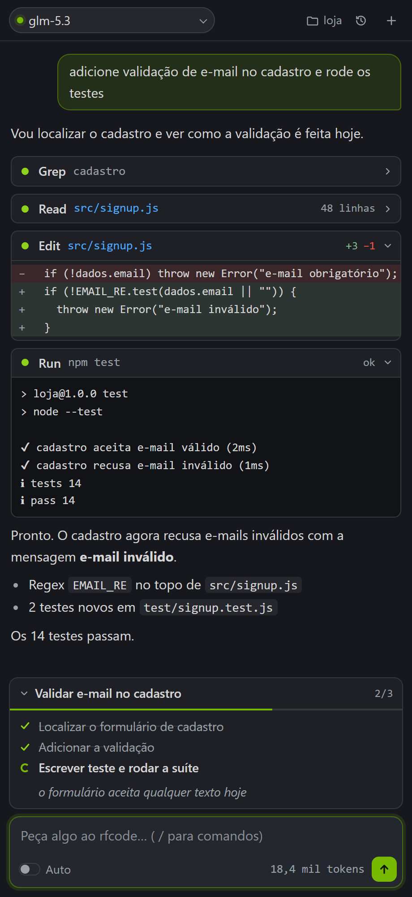
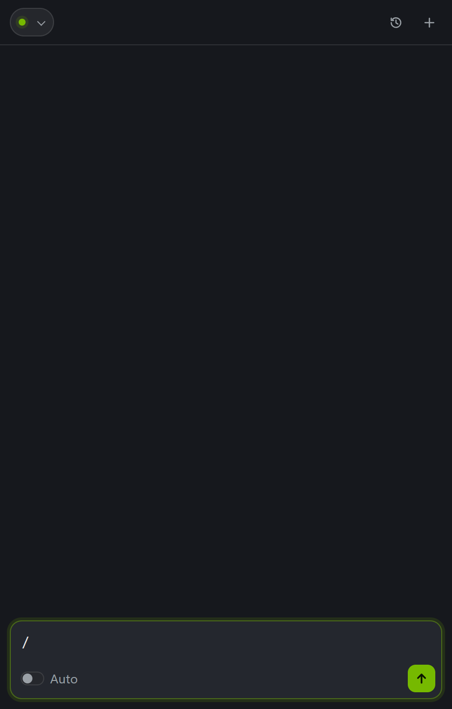
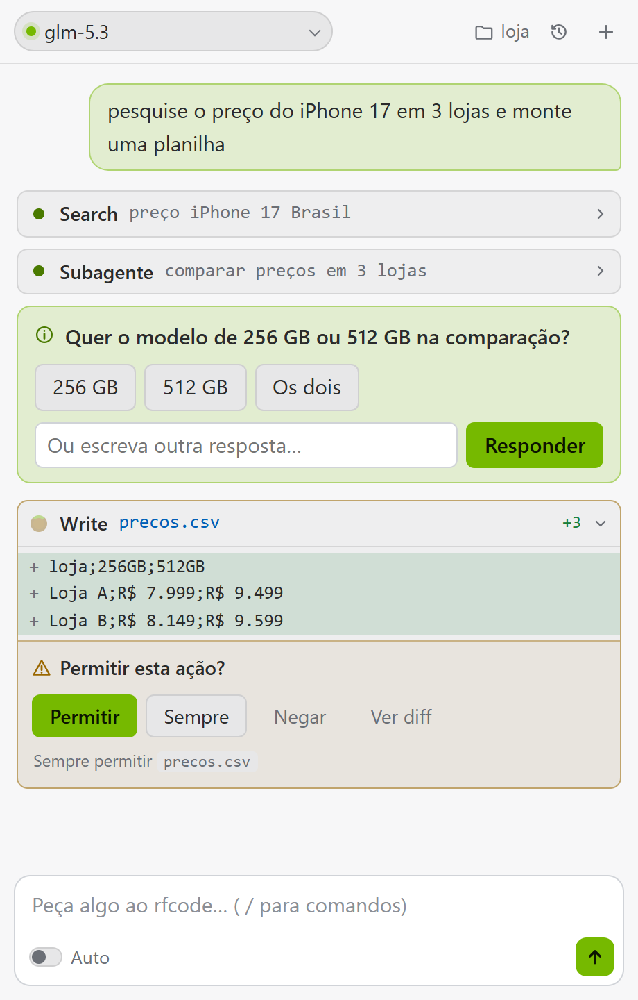
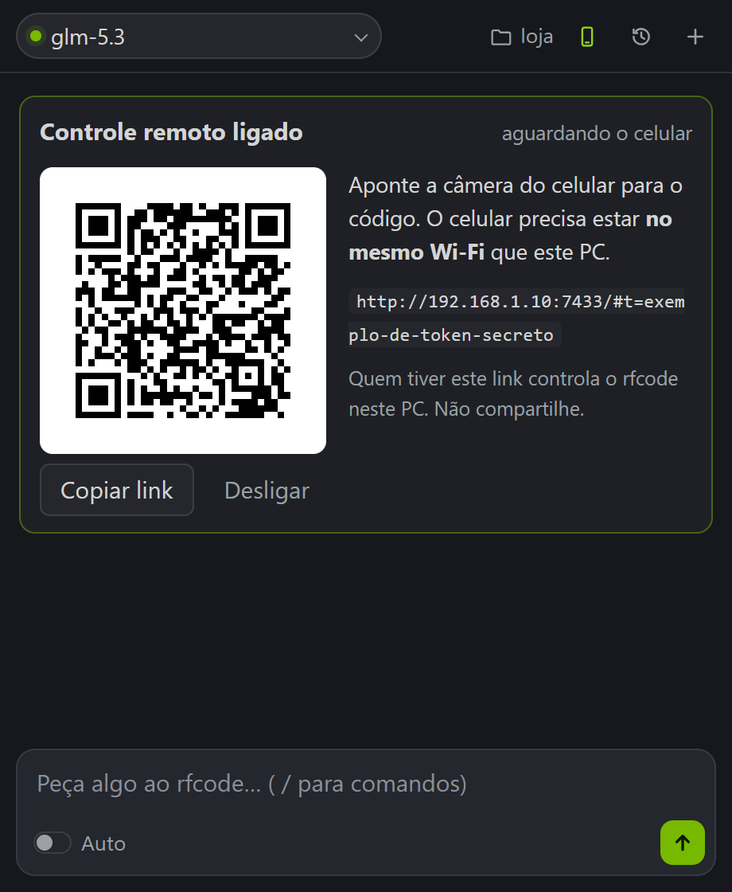

# rfcode

[](https://github.com/devrenanferrari/rfcode/actions/workflows/ci.yml)

Agente de IA para VS Code e terminal. Funciona com os modelos gratuitos de [build.nvidia.com](https://build.nvidia.com) e com outros provedores (OpenRouter, Groq, OpenAI, Anthropic, Gemini, DeepSeek, Mistral) ou modelos locais (Ollama, LM Studio). Lê e edita projetos, executa comandos e testes, usa git, pesquisa na web, gera documentos e vídeos e automatiza tarefas no Windows. Toda ação que altera arquivos ou o sistema passa por aprovação.

AI agent for VS Code and the terminal. Works with NVIDIA's free models, other OpenAI-compatible providers and local models. The interface is in Brazilian Portuguese.

| Conversa | Comandos | Aprovação |
|---|---|---|
|  |  |  |

## Instalação

Pelo VS Code: procure por rfcode na aba de extensões (`Ctrl+Shift+X`).

Pelo arquivo: baixe o `.vsix` em [Releases](https://github.com/devrenanferrari/rfcode/releases) e instale com `code --install-extension rfcode.vsix`.

Na primeira execução, o rfcode pede uma API key da NVIDIA. Gere a sua em [build.nvidia.com](https://build.nvidia.com) (Get API Key). A chave fica no armazenamento seguro do VS Code. Para usar outro provedor, veja [Provedores](#provedores).

## Recursos

- Código: leitura, busca, edição (incluindo várias edições atômicas no mesmo arquivo), execução de comandos e testes, git e desfazer.
- Documentos: gera apresentações PowerPoint com gráficos e diagramas nativos e editáveis (colunas, empilhado, barras, linha, pizza, rosca e cascata com CAGR e setas de diferença; processo, linha do tempo, funil, pirâmide, matriz 2x2, ciclo, cartões, hub, Venn, TAM/SAM/SOM e tabelas), conclusão em destaque, fontes e notas do apresentador, em 7 temas. Gera Word a partir de markdown e lê PDF, Word, PowerPoint e Excel.
- Vídeo: gera vídeos com narração em português e legendas. Saída em WebM, ou MP4 quando o ffmpeg está instalado.
- Pesquisa: busca na web com citação das fontes e subagentes para pesquisas mais amplas.
- Navegador: controla uma instância própria do Chrome. Envio de formulários, pagamentos e exclusões sempre exigem confirmação.
- Memória: guarda preferências do usuário entre conversas (`/memory`).
- Desenvolvimento: lê os diagnósticos do VS Code, abre o diff no editor antes da aprovação e executa processos em segundo plano.
- Windows: controle de janelas, leitura de tela por OCR local, cliques e teclado. Nenhuma imagem da tela é enviada para fora do computador.

Exemplos de slides gerados (temas consultoria e papel):


- Controle remoto: uso pelo celular na mesma rede, com pareamento por QR code.

## Comandos

Digite `/` no campo de mensagem para abrir a lista.

| Comando | Descrição |
|---|---|
| `/help` | Lista os comandos |
| `/new` | Inicia uma conversa (alias: `/clear`) |
| `/history` | Abre o histórico (alias: `/resume`) |
| `/model [id]` | Mostra ou troca o modelo |
| `/models [provedor]` | Lista os modelos disponíveis |
| `/provider [provedor]` | Configura um provedor de modelos |
| `/doctor` | Verifica o ambiente, as chaves e as ferramentas |
| `/auto` | Liga ou desliga a aprovação automática |
| `/undo` | Desfaz a última alteração de arquivo |
| `/plan <pedido>` | Investiga e propõe um plano sem alterar nada |
| `/go` | Executa o plano aprovado |
| `/init` | Cria o `RFCODE.md` com as instruções do projeto |
| `/review` | Revisa o `git diff` atual |
| `/compact` | Resume a conversa para liberar contexto |
| `/memory [texto]` | Mostra ou acrescenta itens na memória |
| `/remote` | Liga o controle remoto |
| `/key` | Troca a API key |

Comandos personalizados ficam em `.rfcode/commands/<nome>.md` (projeto) ou `~/.rfcode/commands/` (usuário). O conteúdo do arquivo é o pedido, e `$ARGUMENTS` é substituído pelo texto digitado depois do comando. Uma primeira linha `description: ...` define a descrição exibida no menu.

```markdown
description: Escreve testes para um arquivo
Escreva testes para $ARGUMENTS seguindo o padrão do projeto e execute a suíte.
```

## Controle remoto



Execute `/remote` e leia o QR code com o celular conectado à mesma rede. O celular abre o mesmo painel do VS Code, com conversa, aprovações, plano, histórico e comandos sincronizados.

O link contém um token de acesso e dá controle sobre o rfcode no computador. Não o compartilhe. Para desligar, use o botão Desligar no cartão ou o item rfcode remoto na barra de status. Na primeira vez, o Windows pode pedir permissão de rede; escolha Redes privadas.

## Permissões

Edições, comandos, commits, criação de arquivos e ações no navegador ou no Windows exibem um pedido de aprovação. O modo Auto aprova tudo, exceto envios, pagamentos e exclusões em sites.

A opção Sempre permitir, no pedido de aprovação, grava uma regra. As regras também podem ser escritas em `~/.rfcode/settings.json` (todos os projetos) ou `.rfcode/settings.json` (projeto atual):

```json
{
  "allow": ["run_command:npm test*", "run_command:git status*", "edit_file:src/**"],
  "deny": ["run_command:rm -rf*", "run_command:git push*"]
}
```

Regras `deny` têm prioridade sobre `allow` e valem também no modo Auto.

Automatizar ações em sites pode violar os termos de uso de alguns serviços. Verifique antes de usar.

## Pesquisa na web

A pesquisa usa DuckDuckGo e Bing, sem necessidade de chave. Esses serviços podem limitar consultas automatizadas; nesse caso o agente pesquisa pelo navegador. Para mais estabilidade, configure uma chave da [Brave Search API](https://brave.com/search/api/) em `~/.rfcode/config.json` como `"searchApiKey": "..."`.

## Dados para formulários

O arquivo `~/.rfcode/perfil.md` pode conter os dados que o agente usa ao preencher formulários (contato, formação, experiência, preferências). Dados ausentes são solicitados ao usuário, nunca inventados.

## Provedores

O modelo é escolhido no seletor do painel, que agrupa os modelos por provedor, ou com `/model`. Para adicionar um provedor, use `/provider` (ou a opção Configurar outro provedor no seletor): o rfcode pede a chave, valida e lista os modelos disponíveis.

| Provedor | Prefixo do modelo | Observação |
|---|---|---|
| NVIDIA | sem prefixo | Padrão, gratuito |
| OpenRouter | `openrouter:` | Acesso a vários modelos com uma chave |
| Groq | `groq:` | Camada gratuita, muito rápido |
| OpenAI | `openai:` | |
| Anthropic | `anthropic:` | |
| Google Gemini | `gemini:` | Camada gratuita |
| DeepSeek | `deepseek:` | |
| Mistral | `mistral:` | |
| Ollama | `ollama:` | Local, detectado automaticamente |
| LM Studio | `lmstudio:` | Local, detectado automaticamente |
| Personalizado | `custom:` | Qualquer servidor compatível com a API da OpenAI |

Exemplos: `groq:llama-3.3-70b-versatile`, `ollama:qwen3:8b`, `openrouter:openrouter/auto`. O modelo precisa suportar chamadas de ferramenta.

As chaves também podem vir de variáveis de ambiente (`OPENROUTER_API_KEY`, `GROQ_API_KEY`, `OPENAI_API_KEY`, `ANTHROPIC_API_KEY`, `GEMINI_API_KEY`, `DEEPSEEK_API_KEY`, `MISTRAL_API_KEY`).

Modelos da NVIDIA testados: `nvidia/nemotron-3-super-120b-a12b` (padrão, rápido), `z-ai/glm-5.3` (melhor em tarefas longas) e `openai/gpt-oss-20b` (tarefas simples).

## Conversas e continuidade

- Toda conversa é salva a cada passo. Ao abrir o VS Code, o painel volta para a última conversa da pasta. Se uma tarefa foi interrompida (janela recarregada, processo encerrado), o painel oferece continuar de onde parou.
- Mensagens enviadas enquanto o agente trabalha entram em fila e são consideradas no passo seguinte, sem interromper a tarefa. Se a resposta for interrompida, as mensagens da fila viram o próximo pedido.
- O histórico (ícone de relógio ou `/history`) permite reabrir qualquer conversa.
- Conversas longas são compactadas automaticamente: acima de 65% da janela de contexto do modelo, a parte antiga é resumida e o trecho recente fica literal. O rodapé mostra a ocupação do contexto. Detalhes em [docs/CONTEXT.md](docs/CONTEXT.md).

## Diagnóstico

`/doctor` (ou `rfcode --doctor`) verifica a versão do Node.js, as chaves de cada provedor, os modelos locais, git, Chrome, ffmpeg e a voz de narração. Erros ficam registrados em `~/.rfcode/logs/rfcode.log` (comando rfcode: Abrir log de erros), sem as chaves de API.

## Terminal

A extensão inclui a versão de terminal: `Ctrl+Shift+P` → rfcode: Abrir no terminal. Os comandos `/` são os mesmos. Para executar uma tarefa e sair: `rfcode -p "tarefa"`.

## Configurações

| Configuração | Padrão | Descrição |
|---|---|---|
| `rfcode.model` | `nvidia/nemotron-3-super-120b-a12b` | Modelo usado |
| `rfcode.autoApprove` | `false` | Aprova ações sem perguntar |
| `rfcode.remotePort` | `7433` | Porta do controle remoto |

Arquivos `RFCODE.md`, `CLAUDE.md` ou `AGENTS.md` na raiz do projeto são lidos como instruções para o agente.

## Requisitos

- VS Code 1.90 ou superior.
- Google Chrome ou Microsoft Edge, para o navegador e a geração de vídeo.
- Windows 10 ou 11, para o controle do sistema e a narração de vídeos.

## Licença

MIT
