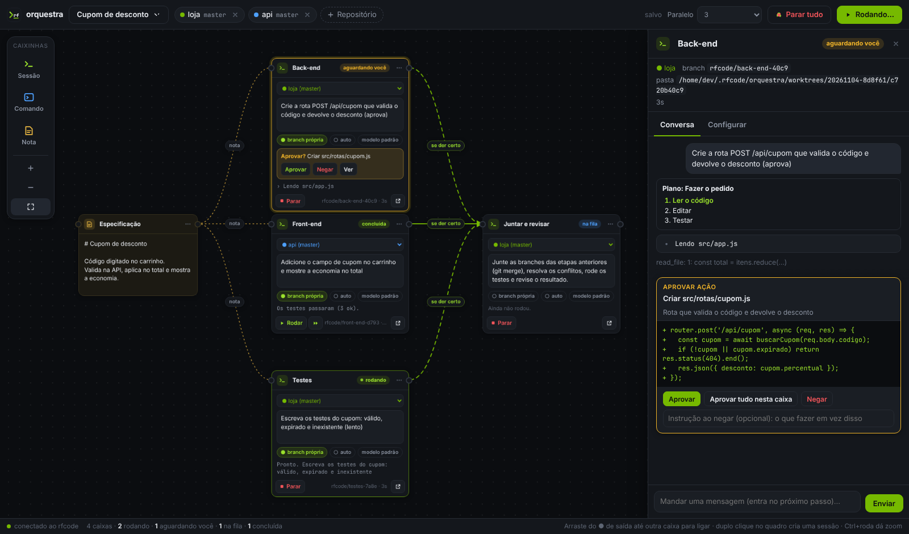

# Orquestra

A orquestra é um quadro no navegador para coordenar várias sessões do rfcode ao mesmo tempo. Cada sessão é uma caixinha; as ligações entre elas são o fluxo. O que não está ligado roda em paralelo, o que está ligado roda em sequência, e o resultado de uma caixa vira contexto da seguinte.

## Abrir

| Onde | Como |
|---|---|
| Terminal | `rfcode orquestra` na pasta do projeto, ou `rfcode orquestra C:\projetos\api C:\projetos\web` para conectar várias pastas |
| Chat (terminal ou VS Code) | `/orquestra` (apelidos: `/quadro`, `/canvas`) |
| VS Code | Paleta de comandos → rfcode: Orquestra, ou o ícone no topo do painel |

O navegador abre no quadro mais recente; as pastas pedidas são conectadas a ele. Opções do terminal:

| Opção | Efeito |
|---|---|
| `--porta <n>` | Porta do servidor (padrão 7434; se estiver ocupada, outra livre) |
| `--rede` | Aceita conexões da rede local, para abrir o quadro em outro computador ou no tablet |
| `--sem-navegador` | Só mostra o link |

A orquestra fica no ar enquanto o terminal (ou o VS Code) estiver aberto. Fechar interrompe as sessões em andamento; o quadro fica salvo, e as caixas interrompidas aparecem como canceladas.

## Repositórios

A barra de cima mostra os repositórios conectados ao quadro. **+ Repositório** abre duas opções:

- **Pasta do computador**: navegue pelas pastas (as que são repositórios git aparecem marcadas) ou cole o caminho.
- **Clonar do Git**: cole o endereço (`https://...`, `git@host:dono/repo.git` ou `ssh://...`). O clone usa o git e o login do seu computador e vai para `~/.rfcode/orquestra/repos`.

Cada caixa escolhe em qual repositório trabalha, então um mesmo fluxo pode mexer no back-end e no front-end, em repositórios diferentes. Desconectar um repositório não apaga nada do disco.

## Caixinhas

Arraste da barra à esquerda para o quadro, dê dois cliques num espaço vazio (cria uma sessão) ou, com uma caixa selecionada, clique num tipo da barra: a nova caixa entra à direita, já ligada depois da selecionada.

| Caixa | O que faz |
|---|---|
| **Sessão** | Uma conversa do agente num repositório. Tem o pedido, o modelo, o esforço e duas opções: **branch própria** e **auto** (aprova sozinha). |
| **Comando** | Roda um comando no terminal (testes, build, lint, deploy). Código de saída 0 é sucesso; qualquer outro é falha. Tem limite de tempo (padrão 30 min). |
| **Nota** | Texto em markdown compartilhado. As sessões ligadas a uma nota recebem o texto no pedido e ganham as ferramentas `nota_ler` e `nota_escrever`, então uma sessão pode escrever um plano que a próxima segue. |

Renomeie com dois cliques no título. O botão `...` do cartão tem rodar, puxar a próxima etapa já ligada, duplicar e excluir. Atalhos: `Delete` exclui a seleção, `Ctrl+D` duplica, `Enter` abre a caixa selecionada, `Ctrl+Enter` no pedido roda a caixa, `Ctrl+Enter` fora dos campos roda o fluxo, `F` enquadra tudo, `Esc` fecha.

## Ligações e fluxo

Arraste do ponto de saída (à direita do título) até outra caixa. Também dá para arrastar do ponto de entrada (à esquerda) até a caixa de origem.

- **Sequência**: B ligada depois de A espera A terminar e recebe o resultado de A como contexto (o resumo final da sessão, ou a saída do comando).
- **Paralelo**: caixas sem caminho entre si rodam juntas, até o limite escolhido em **Paralelo** na barra de cima. Com 1, tudo roda em sequência, uma caixa de cada vez.
- **Junção**: uma caixa com várias entradas espera todas e recebe o resultado de todas.
- **Condição**: o rótulo no meio da ligação diz quando o fluxo segue: **se der certo** (padrão), **se falhar** ou **sempre**. Clique no rótulo para trocar. Se a condição não for atendida, a caixa seguinte é pulada, e o motivo aparece nela.
- Ciclos não são permitidos: o quadro recusa a ligação que faria o fluxo voltar para trás.
- Ligações com notas (tracejadas) não são dependência: só dizem quais sessões leem e escrevem naquela nota.

Para rodar:

| Botão | Roda |
|---|---|
| **Rodar fluxo** (barra de cima) | Todas as caixas do quadro, respeitando as ligações |
| **Rodar** (cartão) | Só aquela caixa. As caixas ligadas antes não rodam de novo; o último resultado delas entra como contexto |
| **▶▶** (cartão) | A caixa e tudo o que vem depois dela |

**Parar** no cartão interrompe uma caixa (as seguintes são puladas); **Parar tudo** interrompe o quadro.

## Branch própria (git worktree)

Duas sessões editando a mesma pasta ao mesmo tempo atrapalham uma à outra. Com **branch própria**, a sessão trabalha numa git worktree em `~/.rfcode/orquestra/worktrees/<quadro>/<caixa>`, numa branch `rfcode/<título>-<id>` criada a partir do commit atual. A pasta principal do repositório não é tocada.

- As caixas seguintes do mesmo repositório continuam na mesma worktree: implementar → testar → corrigir acontece na mesma branch.
- Uma caixa que junta várias branches (por exemplo, três sessões paralelas → "Juntar e revisar") roda na pasta principal, onde o merge faz sentido.
- Rodar a caixa de novo reaproveita a worktree e a branch.
- Precisa de um repositório git com pelo menos um commit.

As worktrees não são apagadas sozinhas, porque podem ter trabalho não commitado. Para limpar: `git worktree list` e `git worktree remove <pasta>` no repositório.

## Conversa, aprovações e mensagens

O cartão mostra o estado (parada, na fila, rodando, concluída, falhou, cancelada, pulada), a última ação, a branch, o tempo e os tokens. **Abrir** (ou dois cliques no cartão) mostra ao lado:

- **Conversa**: o pedido, o plano, cada ação com o resultado, a saída dos comandos e a resposta final, ao vivo.
- **Configurar**: repositório, pedido, modelo, esforço, branch própria, auto e o último resultado.
- **Mensagem**: enquanto a sessão trabalha, a mensagem entra no próximo passo; depois que terminou, continua a mesma conversa.

Edições, comandos e outras ações que pedem aprovação aparecem no cartão (Aprovar, Negar) e na conversa, com a prévia da mudança. **Aprovar tudo nesta caixa** liga o modo auto dela. As regras de `.rfcode/settings.json` (`allow` e `deny`) e a política da empresa continuam valendo. Perguntas do agente (`ask_user`) aparecem do mesmo jeito.

As conversas das sessões também ficam no histórico normal do rfcode (`/history`), com a pasta do repositório (ou da worktree).

## Modelos de quadro

Em **Novo quadro**:

- **Paralelo + revisão**: três sessões em branches próprias (back-end, front-end, testes), todas lendo a nota "Especificação", e uma quarta que junta e revisa.
- **Implementar, testar e corrigir**: sessão em branch própria → comando de testes → se falhar, sessão que corrige; se passar, sessão que prepara o pull request.
- **Planejar, executar e revisar**: uma sessão escreve o plano na nota "Plano", a seguinte executa e a última revisa o diff.

## Segurança

- Por padrão o servidor só aceita conexões do próprio computador (127.0.0.1) e confere o cabeçalho Host, o que impede que um site aberto no navegador alcance o servidor por DNS rebinding.
- Todo pedido à API exige o token do link, num cabeçalho próprio. Outro site não consegue mandar esse cabeçalho, então não consegue disparar sessões em seu nome.
- O link muda a cada vez que a orquestra abre. Quem tem o link controla as sessões e os comandos no seu computador: não compartilhe.
- `--rede` abre para a rede local. Use só em redes de confiança.
- O clone aceita apenas endereços `https://`, `git@` e `ssh://` e roda o git sem shell.

## Arquivos

| Caminho | Conteúdo |
|---|---|
| `~/.rfcode/orquestra/quadros/<id>.json` | Quadro: repositórios, caixas, ligações e o último estado de cada caixa |
| `~/.rfcode/orquestra/worktrees/` | Worktrees das sessões com branch própria |
| `~/.rfcode/orquestra/repos/` | Repositórios clonados pelo quadro |
| `~/.rfcode/sessions/` | Conversas das sessões (as mesmas do `/history`) |

## Para desenvolvedores

| Arquivo | Papel |
|---|---|
| `lib/orquestra.js` | Normalização do quadro, grafo das ligações, modelos, worktrees e o executor (`Orquestra`), que emite eventos `caixa`, `log`, `pedido`, `pedidoFim` e `execucao` |
| `lib/orquestra-server.js` | Servidor HTTP: página, API JSON (`/api/...`), eventos ao vivo por SSE (`/api/eventos`) e `startOrquestra` |
| `media/orquestra.js`, `media/orquestra.css` | A tela do quadro, sem dependências |
| `test/orquestra.test.js` | Testes do executor, do git e do servidor (com agentes simulados, sem rede) |

O executor recebe `createAgent({ cwd, model, effort, extraTools })`, então dá para trocar o agente nos testes ou em outras interfaces.
